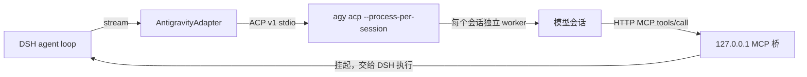

# dsh-llm-antigravity-acp

把本机已登录的 Google Antigravity CLI（`agy`）作为 DeepSeek Harness 的一级模型 provider 接入。模型出现在输入框右下角的模型选择器里，与 DeepSeek、GLM 等直连 provider 同级使用；工具、权限、压缩、子代理全部由 DSH 负责。

## 工作方式



| 环节 | 做法 |
|---|---|
| 进程 | 由 `ctx.subprocess` 启动本机官方 `agy acp`，凭据留在官方进程与系统凭据库（macOS 钥匙串 / Windows 凭据管理器） |
| 客户端标识 | ACP `clientInfo.name` 使用 `jetbrains.dsh`。Antigravity 只向 JetBrains / Zed / Xcode 等白名单客户端下发 Claude 与 GPT-OSS 模型；普通客户端名称只看到 Gemini |
| 隔离 | 独立 `--gemini-dir`（默认 `$DSH_HOME/cache/antigravity-acp`），不加载用户全局规则、技能、MCP；`dsh-bridge` agent 以 `tools: []` + `excludeDefaultComponents: true` 去掉全部内置工具 |
| 工具 | DSH 工具经每会话独立的 MCP 端点暴露为 `mcp_dsh_<name>`；调用挂起，当前 DSH step 以 `finish(tool-calls)` 结束，DSH 审批并执行后在下一 step 回填，原 ACP turn 继续生成。会话创建时冻结 MCP `tools/list` 声明以固定前缀保住 Gemini 隐式缓存；中途按需解锁或禁用工具不重建会话，实时更新宿主白名单并经 `<harness_tool_update>` 增量下发 Schema，由内置 `dsh_call_tool` 原地调用 |
| 长时工具 | agy 对单次 MCP 调用有 180 秒上限且 Gemini 隐式缓存存在空闲 TTL；默认超过 85 秒（`relayAfterMs`）的调用先返回“仍在运行”提示，模型调用 `dsh_await_result` 继续等待同一结果并刷新缓存活跃度，DSH 侧只看到一次工具调用 |
| 历史 | 同一 DSH 会话复用同一 ACP 会话，只发送新增输入；压缩、编辑或历史回退时按 DSH 历史重建（`<dsh_history>` 转录 + 最新输入）。重放按字节预算保留尾部：解锁时 2.2MB，未解锁时 160KB（低于 agy 单条 `USER_INPUT` 的 192KB 截断线），从最旧消息开始省略并在块内标注，最新用户输入始终完整保留 |
| 系统提示 | 首次经 `_meta.antigravity.systemPrompt.append` 注入；声明 `systemPromptUpdate: in-history`，后续变化作为 `<system_update>` 增量发送 |

> 背景：Antigravity 的 ACP 服务按 `clientInfo.name` 白名单下发第三方模型（JetBrains / Zed / Xcode 可见，其余客户端只看到 Gemini），见 [antigravity-cli#1318](https://github.com/google-antigravity/antigravity-cli/issues/1318)；CLI 的 `agy models` 与 `agy -p --model` 本身已支持这些第三方模型。插件因此只在 ACP 握手里使用白名单标识，不修改官方二进制，也不接管登录态。模型与套餐矩阵见 [Choose a model](https://antigravity.google/docs/models/)。

## 原生体验对照

| 能力 | 实现 |
|---|---|
| 上下文窗口 | 按模型分别声明：Gemini 4 Argon / 3.8 Flash 与 Claude Opus 5.5 在解锁后为 `1,048,576`（输入、思考、输出共享）；未解锁时统一按 `256,000`。不预扣 `defaultMaxTokens`；DSH 默认在窗口的 80% 触发压缩。解锁脚本同步打开 Gate 4A/4B（解除 `getMaxTokensForStep` 与 `DefaultSerializer.stepToMessage` 原 64K / 192KB 单步 `USER_INPUT` 上限），支持完整重放大体量历史上下文 |
| 思考强度 | `Low` / `Medium` / `High` 三档，映射 ACP `thought_level`，同会话内切换不重建 |
| 思考流 | `agent_thought_chunk` → reasoning 块 |
| 用量与上下文表盘 | 经 `node:sqlite` 只读读取本机 `$home/agy/conversations/<sessionId>.db` 的 `steps` 表（`step_type = 15` Protobuf `ModelUsageStats`），在每个 `tool-calls` 步与最终 `stop` 步逐步精确上报真实单步不相交 `TokenUsage`（`inputTokens` 为未命中缓存输入，缓存读/写与输出独立计入总量，首步无命中时显式携带 `cacheReadTokens: 0`），直接点亮 DSH 多步用量面板与底部圆环 `ContextMeter`；无会话库环境自动回退至轮末归一化用量 |
| 子代理 | 每个 `(sessionId, purpose)` 一个 ACP 会话，父会话等待工具期间子代理并发运行；`spawn` / `fork` / `team` / `workflow`、标题生成、压缩摘要互不阻塞 |
| 长输出 | `max_tokens` 停止时在同会话自动续写（默认 3 次） |
| 图片 | DSH 附件以 ACP 图片块发送；工具返回的图片以 MCP 图片内容回填 |
| 取消与重试 | 取消发送 `session/cancel` 并释放挂起调用；错误映射到 `AUTH` / `QUOTA` / `RATE_LIMIT` / `TIMEOUT` / `TRANSPORT` / `SERVER`，由 `dsh-llm-retry` 退避重试 |
| 额度 | 输入框旁药丸优先显示当前模型组每周剩余比例，点击展开可查看每周与 5 小时窗口详情及重置倒计时（`agy -p /usage`，不消耗模型额度）；设置页同步按每周优先展示套餐额度、连接状态、上下文与解锁状态 |
| 设置行 | 上下文窗口、默认思考、超长续写三项在设置页与模型菜单里都是同一套行式控件：左侧标签、右侧当前值与 `›`，点开在同一张卡片内展开候选值（当前项打勾），选中即通过 `configure` 生效，菜单不关闭；不再使用绿色描边胶囊 |

## 安装

前提：已安装官方 `agy` CLI（`>= 1.5.0`，旧版先执行 `agy update`）并在终端运行过一次完成登录。

### 方式一：直接从 GitHub 插件仓库子目录安装（预编译产物，免本地构建）

```sh
dsh plugin --profile web add "git+https://github.com/lili-luo/dsh-plugin-bundle.git#main&path:/dsh-llm-antigravity-acp"
```

### 方式二：从本地目录或源码仓库安装

```sh
cd plugins/dsh-llm-antigravity-acp
npm run build
cd ../..
pnpm dsh plugin --profile web add ./plugins/dsh-llm-antigravity-acp
```

重启 Web 后，在模型选择器的 **Antigravity** 分组中选择模型，并在右侧选择思考档位。

安装插件不会改写官方 `agy`。上下文窗口默认仍是 256K。要放到约 1M，另外使用同仓库的 [`agy-context-unlock`](../agy-context-unlock)，把 `agy-patch.py` 放到 `~/.gemini/antigravity/tools/agy-patch.py`（Windows 为 `%USERPROFILE%\.gemini\antigravity\tools\agy-patch.py`）。插件下次启动时，`autoPatch` 会去这个路径查找并调用它；找不到就保持官方的 256K。`agy` 升级后插件启动时会自动检查并重打补丁。

| 模型 | 上下文 | 思考档位 |
|---|---|---|
| Gemini 4 Argon | 1,048,576（解锁后；未解锁 256,000） | Low / Medium / High |
| Gemini 3.8 Flash | 1,048,576（解锁后；未解锁 256,000） | Low / Medium / High |
| Claude Opus 5.5 | 1,048,576（解锁后；未解锁 256,000） | Low / Medium / High |
模型目录以 ACP `session/new` 返回的 `models.availableModels` 为准：套餐没有开通的模型不会显示。Claude Sonnet 5.5 与 GPT-OSS 120B 默认在 `catalog.ts` 的 `HIDDEN_MODEL` 中隐藏；删除对应 id 即可重新显示。

## 配置

| 字段 | 默认值 | 说明 |
|---|---|---|
| `provider` | `antigravity` | 路由 id |
| `command` | 空 | `agy` 绝对路径；空则在 macOS / Linux 查找 `~/.local/bin/agy` 与 `PATH`，在 Windows 查找 `%LOCALAPPDATA%\agy\bin\agy.exe`、`~/.local/bin/agy.exe` 与 `PATH` |
| `home` | 空 | 隔离目录；空则 `$DSH_HOME/cache/antigravity-acp` |
| `contextWindow` | `0` | 全局覆盖窗口；`0` 按模型选择：Gemini/Claude 解锁后 1,048,576、否则 256,000（可在设置页即时修改） |
| `defaultEffort` | `high` | 请求未带档位时使用（可即时修改） |
| `autoPatch` | `true` | 启动前用本机 `agy-patch.py` 检查上下文解锁，未解锁时应用 |
| `patchScript` | 空 | 解锁脚本；空则 `~/.gemini/antigravity/tools/agy-patch.py` |
| `maxLiveSessions` | `16` | 同时保留的 ACP 会话上限 |
| `idleSessionTtlMs` | `1800000` | 空闲会话回收时间 |
| `parkSettleMs` | `250` | 并行工具调用归并窗口 |
| `relayAfterMs` | `85000` | 长耗时工具返回“仍在运行”中继提示前的等待时间（毫秒，`5000..165000`），用于在 Gemini 缓存 TTL 过期与 `agy` 180 秒上限前续期保活 |
| `longDecodeContinuations` | `3` | 自动续写次数（可即时修改） |
| `warmup` | `true` | 加载时启动进程并读取模型目录 |

## 限制

- Claude 依赖 ACP 客户端白名单。插件使用 `jetbrains.dsh` 标识换取第三方模型目录；若上游收紧该白名单，模型列表会退回 Gemini。
- Claude 的额度、速率限制和可用性随 Antigravity 套餐变化，插件不额外做路由或降级。
- Claude Sonnet 5.5 与 GPT-OSS 120B 仍可被已保存的会话选中并正常运行，但不会出现在模型选择器里。
- ACP 无采样参数通道，`temperature`、`stop`、`maxTokens` 不生效。
- 逐步精确用量依赖 Node 内置 `node:sqlite` 与 `agy` 本地会话库 `steps` 表；若运行环境缺少二者，自动回退为轮末按调用次数归一化的 `TokenUsage`。
- 隔离目录保留 `manage_task`、`list_resources`、`read_resource` 三个 agy 无副作用工具；其余内置工具不可用，原生权限请求一律拒绝。

## 测试

```sh
npm run build && npm test
```

测试使用 `tests/fake-agy.mjs` 模拟 `agy acp` 与 MCP 客户端，覆盖流式思考与正文、精确用量、工具挂起与回填、并行工具、会话复用与重建、子代理并发、长时工具续等、追加输入、取消、长输出续写、辅助会话与图片输入。

## 社区

本项目在 [LINUX DO](https://linux.do) 社区进行开源推广，感谢社区佬友的交流、反馈与建议。
